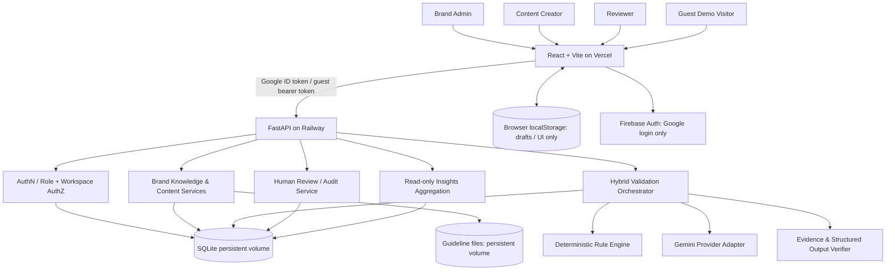

# BrandSentry — 10,000-ft Architecture

Status: proposed Round 2 blueprint; verify build window before implementation.

## A. System context

## B. Bounded components
1. `web/` React application: navigation, identity state, API client, forms, findings, reviewer flows, async/error states, accessibility.
2. `api/` FastAPI: versioned REST endpoints; request/response validation; auth middleware/dependencies; CORS; readiness; error contract.
3. `services/` brand/content/review domain logic; never trust UI role flags; status transition policy.
4. `validation/`: text normaliser, deterministic rules, retrieval from approved knowledge, Gemini adapter, post-verification, merging and deduping findings.
5. `repositories/`: SQLAlchemy implementations for domain persistence; separate interfaces/services from SQL so later Firestore migration is possible if approved.
6. `storage/`: server-side files with content-hash IDs, safe paths, size/type validation and source records.
7. `operations/`: SQLite-backed limits, provider quota ledger, result cache, idempotency, observability.

## C. Critical flows
**Google identity:** Firebase JS sign-in -> ID token sent via HTTPS Authorization bearer -> backend Admin SDK verification -> map `firebase_uid` to internal user & workspace -> server-side role check -> business service.

**Guest:** `POST /api/v1/auth/guest` -> server makes cryptographically random time-limited opaque session secret; store only its hash+scope+expiry in DB -> frontend holds transient token in sessionStorage (or in memory with fresh session on refresh) -> backend checks session and demo workspace on every request. Isolate each guest's demo workspace. No Firebase dependency. Explicit demo actor switching is sandbox-only and visibly labelled.

**Validation:** versioned content + approved guideline snapshot -> preflight (input size, authZ, quota, fingerprint, cache/idempotency) -> deterministic rules -> curated source retrieval -> Gemini call if allowed -> Pydantic schema verification -> evidence/source IDs verified against knowledge snapshot -> findings persisted, AI status recorded. If provider unavailable, deterministic results are honest partial output; no phantom pass.

**Review:** request review for validated exact content version -> reviewer assigned role performs approve/request changes -> decision and event written in one DB transaction -> approved state references exact immutable content version; corrections create a new draft version and invalidate previous validation for that new version.

## D. Data and trust boundaries
- Trust boundary A: Browser is untrusted. Never trust claimed role, workspace, approval, evidence source, quota or raw user ID from UI.
- Trust boundary B: Gemini response is untrusted generated content. Only registered source IDs may appear as **verified evidence**; invalid IDs are dropped and marked unverified.
- Trust boundary C: uploaded files are untrusted; validate MIME/extension/size, sanitize names, avoid path traversal, apply bounded extraction/timeouts, never execute document macros/code.
- Trust boundary D: another user's workspace is private. Scope EVERY query/cache/file path/limit by authorised workspace.
- Logs contain request IDs/status/timing, not raw confidential contents or access tokens.

## E. Round 2 persistence (one-instance MVP)
- SQLite is the single backend system of record, via SQLAlchemy + Alembic; local `.data/db/brandsentry.sqlite` (under `backend/`), deployed `/data/db/brandsentry.sqlite` on Railway volume.
- Files: local `.data/uploads/`, deployed `/data/uploads/` on the **same** or otherwise explicitly mounted persistent volume; never store sensitive uploads in Vercel or app Git.
- SQLite: enable foreign keys, appropriate `busy_timeout`, WAL if supported; short DB transactions, single app instance/writer planning, backup before schema migrations.
- File + database operations aren't inherently atomic; use upload staging, write metadata after successful file move and cleanup on failure.
- Browser localStorage stores theme/optional unsent text drafts only; do not store privileged tokens, authoritative status, approved guideline data or confidential PDFs there.

## F. Security, resilience and operations
- HTTPS-only external traffic; restrictive CORS allow-list (live frontend and intentional localhost dev origins; not `*` with credentials).
- Short-lived guest sessions, expiry/revoke support, workspace segregation, session quotas. Google users receive workspace/role mapping in server DB.
- Async Gemini invocation with client timeout; bounded retries only for transient errors and only if budget allows; no blind retry storms.
- Stable result cache and idempotency keyed to workspace+content version+guideline version+model+prompt/rules versions (details: AI_VALIDATION).
- Rate limits per actor/workspace/IP plus global provider budget, enforced server-side. Database-backed limits suitable for a single service; Redis only if deployment requirements justify.
- `/health` lightweight process alive; `/ready` verifies volume path and DB connectivity; neither calls Gemini on every request.
- No approval if unresolved review controls are bypassed; all human actions in audit timeline.

## G. Deployment topology
- Vercel: frontend static SPA, correct root `/frontend` when implemented, build env `VITE_API_BASE_URL`, Firebase client config (not secret), SPA deep-route rewrite.
- Railway: FastAPI HTTPS service, one persistent volume mounted `/data`, env config secrets, healthcheck `/ready`, instance sized for controlled Gemini requests and SQLite.
- Build artifact separate from mutable data; volume is mounted at runtime. Schema migration cannot assume volume during build/predeploy phases.
- GitHub: branch/PR CI + release checklist; no production deploy until build window begins and launch is approved.

## H. Migration boundary (future, not automatic)
Repository interfaces cover `users`, `workspaces`, `sources`, `submissions`, `findings`, `decisions`, `audit`, `quota/cache`; migration to Firestore requires modeling queries/indexes/transactions, data backfill, testing and a new ADR. Do **not** claim switching is simply a connection string change.

## I. Diagram scope and exclusions
This is the system-context / service architecture. Exact entities, endpoint schemas, security and state transitions live in DATA_API_CONTRACTS.md; UI visuals stay intentionally flexible as documented in PRD.md.

## J. Phase 5A implemented human-review boundary

Human review uses `services/review.py` and three routes under
`/api/v1/validation-runs/{run_id}/review`. `review_states` is a per-run
projection; `review_decisions` combines append-only decisions and their
audit events, committed atomically under a short SQLite writer transaction.
Machine output and evidence snapshots remain owned by validation and are
never rewritten by review. Existing submission status is still machine
validation status; human status and current-run applicability are exposed
separately in review detail. A new version/run does not inherit approval.
Real authors cannot review their own content; isolated demo self-review is
explicitly labelled. See DATA_API_CONTRACTS §12 for the shipped policy,
revision/idempotency controls and exact frontend contract.
