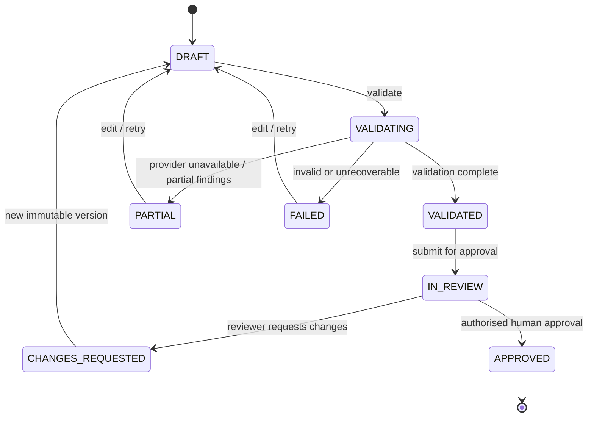

# BrandSentry — Data Model, API Contracts and State Machine

Status: implementation proposal, not existing code. Stack: FastAPI + Pydantic + SQLAlchemy/Alembic + SQLite. All routes are **planned**, not implemented.

## 1. Core modelling rules
- UUID or ULID-style public IDs; DB-generated timestamps in UTC; scoped queries by authenticated workspace. Never expose sequential ID enumeration as authorisation.
- Each meaningful resource has `created_at`, `updated_at` where useful; records referenced by audit must not be silently deleted.
- Uploaded source is immutable per **source_version**. Changing a guideline creates a new version and requires revalidation for new submissions.
- Content versions are immutable snapshots. Review actions target an exact version+validation run, not whatever the creator last edited.
- Transactions commit state transition + audit event atomically.
- Use indexes on `(workspace_id, status, created_at)`, `(workspace_id, submission_id, version)`, `(workspace_id, content_hash)` and foreign keys.

## 2. Planned entities
| Entity | Essential fields | Notes |
|---|---|---|
| `users` | id, firebase_uid nullable unique, display_name, created_at | Guest actors are not fake Firebase users. |
| `workspaces` | id, name, kind=`real|demo`, created_at | Demo workspace unique per guest session, with expiry/cleanup. |
| `memberships` | workspace_id, user_id, role=`admin|creator|reviewer` | Backend enforces. Admin role assignment never set from client input. |
| `guest_sessions` | id, token_hash, workspace_id, expires_at, revoked_at, quota_tier | Never store raw guest token. |
| `knowledge_sources` | id, workspace_id, title, type, active_version_id, status | Guidelines, approved facts, terminology; source record has owning workspace. |
| `source_versions` | id, source_id, version, storage_path, sha256, captured_text, created_at | Content-based version and optional file location. |
| `knowledge_rules` | id, workspace_id, source_version_id, section_ref, category, rule_text, matcher_type, enabled | Every deterministic rule points to approved source. |
| `submissions` | id, workspace_id, created_by, title, status, created_at | Logical item across revisions. |
| `content_versions` | id, submission_id, version, text, text_sha256, uploaded_file_id, created_by | Immutable submission snapshot. |
| `validation_runs` | id, content_version_id, source_set_hash, rules_version, prompt_version, model_id, state, partial_reason, cache_hit, token_usage | Captures engine state. |
| `findings` | id, validation_run_id, category, severity, snippet, start_offset, end_offset, explanation, suggested_text, verification_status, source_version_id nullable, section_ref nullable | Evidence status is separate from severity. |
| `review_decisions` | id, submission_id, content_version_id, validation_run_id, actor_id_or_demo_persona, decision, comment, created_at | Only authorised reviewer / labelled demo reviewer. |
| `audit_events` | id, workspace_id, actor_kind, actor_ref, event_type, entity_id, payload_json_redacted, created_at | Append-only at service layer; never event-free approval. |
| `usage_counters` | scope, period_start, period_type, used, reserved | Reserve provider budget atomically before invocation. |
| `result_cache` | key_digest, workspace_id, response_json, created_at, expires_at, schema_version | Never cache human approval or leak between workspaces. |
| `idempotency_records` | actor_scope, route, key, request_hash, response_ref, created_at | Conflict if same key changes payload. |

**Development simplification:** Some entities may be combined if PRD acceptance criteria, workspace segregation and audit requirements remain intact. Schema changes must update migration and this contract before downstream frontend work.

## 3. Submission and validation state machines

Rules: Review is bound to a validated content version. Partial validation **does not silently count as validated**. Policy on allowing reviewers to inspect/override `Needs Verification` must require documented and explicit human justification, not a hidden transition. Real creators cannot approve their own submission. Editing an approved item starts a new unapproved revision; it does not alter the approved version.

Finding verification status enum: `SUPPORTED`, `NEEDS_VERIFICATION`, `INVALID_SOURCE`, `NOT_APPLICABLE`; verification status never inferred solely from the LLM's self-reported confidence.

## 4. Public HTTP API (proposed: `/api/v1`)
| Method / path | Actor | Purpose |
|---|---|---|
| `GET /health` | public | Cheap liveness (`200` when process live). |
| `GET /ready` | public | DB+volume readiness; no AI call. |
| `POST /auth/guest` | public, rate-limited | Create isolated demo session and return short-lived bearer token. |
| `POST /auth/guest/revoke` | guest | Revoke token. |
| `GET /auth/me` | any signed-in actor | Identity, effective workspace and roles. |
| `GET /workspaces/current` | signed-in | Workspace summary. |
| `GET /knowledge/sources` | member | List approved sources in current workspace. |
| `POST /knowledge/sources` | admin | Create text-source metadata or upload text-based PDF with enforced max size. |
| `POST /knowledge/sources/{id}/versions` | admin | New immutable source version. |
| `GET /knowledge/sources/{id}` | member | Read source and current version metadata. |
| `POST /submissions` | creator | Create submission + v1; accepts explicit text. |
| `GET /submissions` | member | Paginated status list, server scoped. |
| `GET /submissions/{id}` | member | Submission, versions, validation status, audit. |
| `POST /submissions/{id}/versions` | creator | Create revision only if permitted by state. |
| `POST /submissions/{id}/validate` | creator | Idempotent validation for an explicit content version. |
| `GET /validation-runs/{id}` | member | Findings, verified evidence and engine execution state. |
| `POST /submissions/{id}/submit-review` | creator | Request review only for allowed validated version. |
| `GET /reviews/queue` | reviewer | Paginated workspace review queue. |
| `POST /reviews/{submission_id}/decisions` | reviewer | `APPROVE` or `REQUEST_CHANGES` for exact version/run. |
| `GET /submissions/{id}/audit` | member | Filtered immutable audit timeline. |
| `GET /insights/summary` | admin/reviewer | Real aggregated counts (limited to authorised workspace). |

Phase 1 may implement only `/health`, `/ready`, guest auth and `/auth/me` with a placeholder UI; the table describes the future product contract, not an instruction to build everything at once.

## 5. Shape examples (illustrative contract, not fabricated provider output)
`POST /api/v1/submissions/{id}/validate`

Request:
```json
{"content_version_id":"cv_...","idempotency_key":"client-generated-uuid"}
```
Success (`200` cache or `202` processing, choose synchrony explicitly in implementation ADR):
```json
{
  "validation_run_id":"vr_...",
  "state":"VALIDATED",
  "content_version_id":"cv_...",
  "cache_hit":false,
  "ai_status":"COMPLETE",
  "findings":[{
    "id":"find_...","category":"UNSUPPORTED_CLAIM","severity":"HIGH",
    "snippet":"guarantees 100% results",
    "explanation":"No approved evidence supporting the guarantee was found",
    "suggested_text":"Discover how our product may support your routine",
    "verification_status":"NEEDS_VERIFICATION",
    "evidence":{"source_version_id":null,"section_ref":null}
  }]
}
```
**Note:** This request/response is a proposed schema and synthetic example. A real cited `SUPPORTED` rule must point to an actual stored source version; the platform must not invent a policy ID.

Error shape (all failures):
```json
{"error":{"code":"RATE_LIMITED","message":"Validation limit reached","retry_after_seconds":120,"request_id":"req_..."}}
```
Suggested statuses: `400` malformed input, `401` expired/absent identity, `403` forbidden, `404` resource not visible (no cross-workspace leak), `409` stale content version/idempotency conflict, `413` too large, `422` semantic invalid, `429` quota/rate limit with `Retry-After`, `502/503` dependency, `500` unexpected with safe public message.

## 6. API controls
- For state mutations require actor authentication, role and workspace checks, validated Pydantic input and explicit idempotency for costly POST requests.
- No data-changing GET. Use pagination+sort stable cursors; bounded query sizes.
- Validate approved source IDs and file attachments server-side; never assume LLM-generated evidence is valid.
- A cache hit avoids a Gemini call **but still creates/reuses a traceable validation run for the current content version**, preserving audit accountability.
- Do not cache `POST /reviews/*` decisions or `GET /auth/me` using a shared public cache.
- Rate limiting / request budgets are defined in `AI_VALIDATION.md`; backend returns stable error codes to frontend.

## 7. Migration and test obligations
- All schema changes get Alembic revisions, migration path, rollback/backups, and a fresh-DB seed test.
- Build tests for actor/role permutations, state transition invalid cases, duplicate POST, stale version, missing evidence, cache scope, source version mismatch and restart persistence.
- SQLite foreign keys/WAL/busy timeout must be configured and measured for the single-worker MVP; scale-out or provider migration requires a new ADR.
