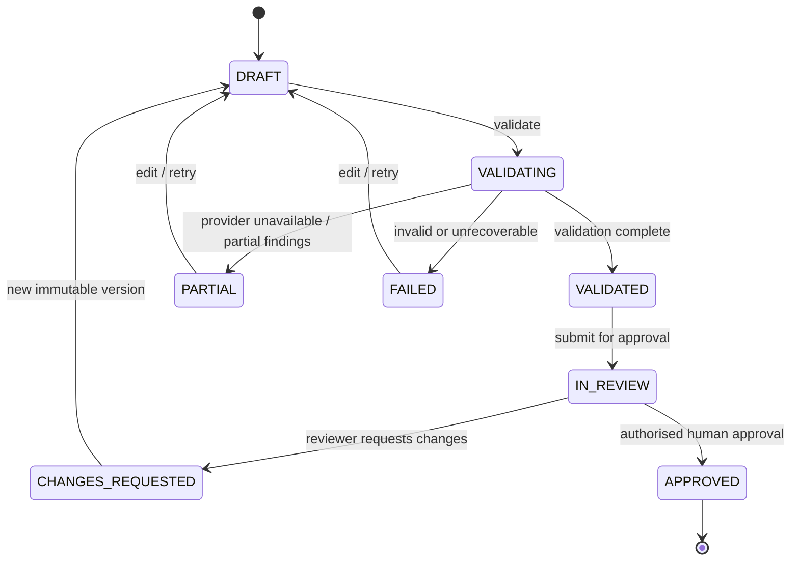

# BrandSentry — Data Model, API Contracts and State Machine

Status: implementation proposal, not existing code. Stack: FastAPI + Pydantic + SQLAlchemy/Alembic + SQLite. All routes are **planned**, not implemented.

## 1. Core modelling rules
- UUID or ULID-style public IDs; DB-generated timestamps in UTC; scoped queries by authenticated workspace. Never expose sequential ID enumeration as authorisation.
- Each meaningful resource has `created_at`, `updated_at` where useful; records referenced by audit must not be silently deleted.
- Uploaded source is immutable per **source_version**. Changing a guideline creates a new version and requires revalidation for new submissions.
- Content versions are immutable snapshots. Review actions target an exact version+validation run, not whatever the creator last edited.
- Transactions commit state transition + audit event atomically.
- Use indexes on `(workspace_id, status, created_at)`, `(workspace_id, submission_id, version)`, `(workspace_id, content_hash)` and foreign keys.

## 2. Planned entities
| Entity | Essential fields | Notes |
|---|---|---|
| `users` | id, firebase_uid nullable unique, display_name, created_at | Guest actors are not fake Firebase users. |
| `workspaces` | id, name, kind=`real|demo`, created_at | Demo workspace unique per guest session, with expiry/cleanup. |
| `memberships` | workspace_id, user_id, role=`admin|creator|reviewer` | Backend enforces. Admin role assignment never set from client input. |
| `guest_sessions` | id, token_hash, workspace_id, expires_at, revoked_at, quota_tier | Never store raw guest token. |
| `knowledge_sources` | id, workspace_id, title, type, active_version_id, status | Guidelines, approved facts, terminology; source record has owning workspace. |
| `source_versions` | id, source_id, version, storage_path, sha256, captured_text, created_at | Content-based version and optional file location. |
| `knowledge_rules` | id, workspace_id, source_version_id, section_ref, category, rule_text, matcher_type, enabled | Every deterministic rule points to approved source. |
| `submissions` | id, workspace_id, created_by, title, status, created_at | Logical item across revisions. |
| `content_versions` | id, submission_id, version, text, text_sha256, uploaded_file_id, created_by | Immutable submission snapshot. |
| `validation_runs` | id, content_version_id, source_set_hash, rules_version, prompt_version, model_id, state, partial_reason, cache_hit, token_usage | Captures engine state. |
| `findings` | id, validation_run_id, category, severity, snippet, start_offset, end_offset, explanation, suggested_text, verification_status, source_version_id nullable, section_ref nullable | Evidence status is separate from severity. |
| `review_decisions` | id, submission_id, content_version_id, validation_run_id, actor_id_or_demo_persona, decision, comment, created_at | Only authorised reviewer / labelled demo reviewer. |
| `audit_events` | id, workspace_id, actor_kind, actor_ref, event_type, entity_id, payload_json_redacted, created_at | Append-only at service layer; never event-free approval. |
| `usage_counters` | scope, period_start, period_type, used, reserved | Reserve provider budget atomically before invocation. |
| `result_cache` | key_digest, workspace_id, response_json, created_at, expires_at, schema_version | Never cache human approval or leak between workspaces. |
| `idempotency_records` | actor_scope, route, key, request_hash, response_ref, created_at | Conflict if same key changes payload. |

**Development simplification:** Some entities may be combined if PRD acceptance criteria, workspace segregation and audit requirements remain intact. Schema changes must update migration and this contract before downstream frontend work.

## 3. Submission and validation state machines

Rules: Review is bound to a validated content version. Partial validation **does not silently count as validated**. Policy on allowing reviewers to inspect/override `Needs Verification` must require documented and explicit human justification, not a hidden transition. Real creators cannot approve their own submission. Editing an approved item starts a new unapproved revision; it does not alter the approved version.

Finding verification status enum: `SUPPORTED`, `NEEDS_VERIFICATION`, `INVALID_SOURCE`, `NOT_APPLICABLE`; verification status never inferred solely from the LLM's self-reported confidence.

## 4. Public HTTP API (proposed: `/api/v1`)
| Method / path | Actor | Purpose |
|---|---|---|
| `GET /health` | public | Cheap liveness (`200` when process live). |
| `GET /ready` | public | DB+volume readiness; no AI call. |
| `POST /auth/guest` | public, rate-limited | Create isolated demo session and return short-lived bearer token. |
| `POST /auth/guest/revoke` | guest | Revoke token. |
| `GET /auth/me` | any signed-in actor | Identity, effective workspace and roles. |
| `GET /workspaces/current` | signed-in | Workspace summary. |
| `GET /knowledge/sources` | member | List approved sources in current workspace. |
| `POST /knowledge/sources` | admin | Create text-source metadata or upload text-based PDF with enforced max size. |
| `POST /knowledge/sources/{id}/versions` | admin | New immutable source version. |
| `GET /knowledge/sources/{id}` | member | Read source and current version metadata. |
| `POST /submissions` | creator | Create submission + v1; accepts explicit text. |
| `GET /submissions` | member | Paginated status list, server scoped. |
| `GET /submissions/{id}` | member | Submission, versions, validation status, audit. |
| `POST /submissions/{id}/versions` | creator | Create revision only if permitted by state. |
| `POST /submissions/{id}/validate` | creator | Idempotent validation for an explicit content version. |
| `GET /validation-runs/{id}` | member | Findings, verified evidence and engine execution state. |
| `POST /submissions/{id}/submit-review` | creator | Request review only for allowed validated version. |
| `GET /reviews/queue` | reviewer | Paginated workspace review queue. |
| `POST /reviews/{submission_id}/decisions` | reviewer | `APPROVE` or `REQUEST_CHANGES` for exact version/run. |
| `GET /submissions/{id}/audit` | member | Filtered immutable audit timeline. |
| `GET /insights/summary` | admin/reviewer | Real aggregated counts (limited to authorised workspace). |

Phase 1 may implement only `/health`, `/ready`, guest auth and `/auth/me` with a placeholder UI; the table describes the future product contract, not an instruction to build everything at once.

## 5. Shape examples (illustrative contract, not fabricated provider output)
`POST /api/v1/submissions/{id}/validate`

Request:
```json
{"content_version_id":"cv_...","idempotency_key":"client-generated-uuid"}
```
Success (`200` cache or `202` processing, choose synchrony explicitly in implementation ADR):
```json
{
  "validation_run_id":"vr_...",
  "state":"VALIDATED",
  "content_version_id":"cv_...",
  "cache_hit":false,
  "ai_status":"COMPLETE",
  "findings":[{
    "id":"find_...","category":"UNSUPPORTED_CLAIM","severity":"HIGH",
    "snippet":"guarantees 100% results",
    "explanation":"No approved evidence supporting the guarantee was found",
    "suggested_text":"Discover how our product may support your routine",
    "verification_status":"NEEDS_VERIFICATION",
    "evidence":{"source_version_id":null,"section_ref":null}
  }]
}
```
**Note:** This request/response is a proposed schema and synthetic example. A real cited `SUPPORTED` rule must point to an actual stored source version; the platform must not invent a policy ID.

Error shape (all failures):
```json
{"error":{"code":"RATE_LIMITED","message":"Validation limit reached","retry_after_seconds":120,"request_id":"req_..."}}
```
Suggested statuses: `400` malformed input, `401` expired/absent identity, `403` forbidden, `404` resource not visible (no cross-workspace leak), `409` stale content version/idempotency conflict, `413` too large, `422` semantic invalid, `429` quota/rate limit with `Retry-After`, `502/503` dependency, `500` unexpected with safe public message.

## 6. API controls
- For state mutations require actor authentication, role and workspace checks, validated Pydantic input and explicit idempotency for costly POST requests.
- No data-changing GET. Use pagination+sort stable cursors; bounded query sizes.
- Validate approved source IDs and file attachments server-side; never assume LLM-generated evidence is valid.
- A cache hit avoids a Gemini call **but still creates/reuses a traceable validation run for the current content version**, preserving audit accountability.
- Do not cache `POST /reviews/*` decisions or `GET /auth/me` using a shared public cache.
- Rate limiting / request budgets are defined in `AI_VALIDATION.md`; backend returns stable error codes to frontend.

## 7. Migration and test obligations
- All schema changes get Alembic revisions, migration path, rollback/backups, and a fresh-DB seed test.
- Build tests for actor/role permutations, state transition invalid cases, duplicate POST, stale version, missing evidence, cache scope, source version mismatch and restart persistence.
- SQLite foreign keys/WAL/busy timeout must be configured and measured for the single-worker MVP; scale-out or provider migration requires a new ADR.

## 8. Phase 2A contract amendments (implemented 2026-10-23)

Amendments to the proposals above, made during Phase 2A implementation:

**Auth delivery — cookie session instead of raw bearer token.**
`POST /auth/guest` and a new `POST /auth/google` no longer return a bearer
token. The backend issues a 256-bit opaque session token delivered as
`brandsentry_session` (HttpOnly, Secure outside development, `SameSite=Lax`
locally / `SameSite=None` on HTTPS cross-site deployments). A companion
JavaScript-readable `brandsentry_session-csrf` cookie mirrors the session-bound
CSRF token; mutating authenticated endpoints require it in `X-CSRF-Token`.
Rationale: HttpOnly cookies keep the session token out of JS reach
(XSS-resistant), which sessionStorage bearer tokens cannot. If cross-site
cookies prove unreliable in production, the approved fallback is a same-origin
BFF/proxy on Vercel, not weaker cookie flags.

**New endpoint: `POST /auth/google`** — body `{"id_token": "<Firebase ID token>"}`.
The backend verifies it with the Firebase Admin SDK (signature, issuer,
audience = `brandsentry-68d05`, expiry) and maps the UID to the local account.
Response is the same payload as `/auth/guest` plus the CSRF token.
`GET /auth/me` / `GET /workspaces/current` / `POST /auth/logout` /
`POST /auth/guest/revoke` are as proposed; `logout` and `guest/revoke` are
`204` and require the CSRF header. Errors keep the Phase 1 error contract:
`401 UNAUTHENTICATED` (absent/expired/revoked session or rejected token),
`403 FORBIDDEN` (CSRF failure, disallowed Origin, non-guest calling
`guest/revoke`), `429 RATE_LIMITED` (guest creation, `Retry-After` header),
`503 SERVICE_UNAVAILABLE` (Firebase verification unavailable — honest failure,
never a bypass).

**Entities.** The proposed `guest_sessions` entity is implemented as a single
`auth_sessions` table (kind `google|guest`, SHA-256 `token_hash` +
`csrf_token_hash`, pinned `workspace_id`, `expires_at`, `revoked_at`, `ip`).
`users` gains `email` (nullable) and `user_kind`; guests keep
`firebase_uid = NULL`. Raw tokens are never stored. Roles are server-assigned
only: Google users become `admin` of a `real` personal workspace, guests
become `admin` of an isolated `demo` workspace. Guest creation is rate-limited
per client IP (DB-backed, default 10/hour, `GUEST_SESSIONS_PER_IP_PER_HOUR`).

## 9. Phase 3A contract amendments (implemented 2026-10-24)

**Brand Knowledge Vault naming.** The proposed `knowledge_sources` +
`source_versions` split is implemented as `knowledge_documents` (logical
source: stable ID, workspace, title, `doc_type`, `active_version`, `status`)
plus `knowledge_document_versions` (immutable snapshot per upload: original
filename, content type, storage path, SHA-256 checksum, size, page count,
extraction status, created_by). Deviation from the table in §2 is naming only;
semantics (immutable per version, workspace-scoped) are unchanged. Supported
`doc_type` values: `guidelines`, `approved_claims`, `terminology`,
`tone_messaging`, `claims_policy`, `source_document`.

**Knowledge status lifecycle.** `pending` on upload → `approved` (admin only)
→ searchable; `rejected`/`deleted` (soft) are excluded from retrieval. A new
upload to an existing document becomes version N+1, resets status to
`pending`, and removes the superseded version's chunks from the FTS index.

**New entities:** `knowledge_chunks` (workspace, document, version,
`section_ref`, nullable `page_number` + `page_end` (inclusive page span; for
plain text both NULL, for single-page chunks equal), text, char offset),
`brand_rules`
(category `prohibited_term|preferred_replacement|restricted_phrase|
claim_requirement|messaging_rule`, `matcher_type` `contains|exact|regex`,
pattern, replacement, `enabled`, integer `version` bumped on each update,
optional source-document provenance), `approved_claims` (`active|retired`),
and `rate_limit_events` (generic DB-backed sliding-window counter — no Redis).

**FTS index.** An SQLite FTS5 external-content table `knowledge_chunks_fts`
mirrors `knowledge_chunks.text` via AFTER INSERT/UPDATE/DELETE triggers
(migrations `0002_knowledge`, `0003_chunk_page_span`). Retrieval joins
chunks→documents and filters
`status='approved' AND active_version = chunks.version`, so unapproved,
superseded, and deleted content can never surface as evidence.

**Endpoints (all under `/api/v1`, cookie session; mutations require
`X-CSRF-Token`; guest and Google actors are both workspace members):**

| Method / path | Roles | Notes |
|---|---|---|
| `POST /knowledge/documents` | admin, creator | Multipart `file` + optional `title`, `doc_type`. Content-inspected (magic bytes / UTF-8), not extension. 413 oversize, 400 unsupported/corrupt/encrypted/empty, 409 duplicate title (concurrent race or title held by a soft-deleted row being reactivated). Duplicate active content is idempotent (`created_new_version: false`). When the extraction cap cuts content short the upload still succeeds but `version.extraction_status` is `incomplete` (otherwise `extracted`); truncated uploads are never silently presented as whole. Response: `UploadResult{document, version, chunk_count, created_new_version}` — storage paths are never exposed. |
| `GET /knowledge/documents` | member | Non-deleted workspace documents. |
| `GET /knowledge/documents/{id}` | member | Document + all version metadata. 404 (not 403) for other workspaces: no existence leak. |
| `GET /knowledge/documents/{id}/chunks?version=` | member | Extracted chunks; defaults to active version. |
| `POST /knowledge/documents/{id}/approve` | admin | Approve active version (409 if none). |
| `DELETE /knowledge/documents/{id}` | admin | Soft delete; chunks leave the index immediately. |
| `POST /knowledge/rules`, `GET /knowledge/rules` | admin / member | Explicit rules only — never auto-extracted from uploads. |
| `PATCH /knowledge/rules/{id}` | admin | Bumps rule `version`. Invalid regex/category → 422. |
| `POST /knowledge/claims`, `GET /knowledge/claims` | admin / member | Approved factual claims; `PATCH` retires/edits. |
| `GET /knowledge/search?q=&top_k=` | member | Lexical FTS5 retrieval (BM25) over approved active knowledge, workspace-scoped. AND-match with OR fallback; sanitised query (no FTS syntax injection). Response: `SearchResponse{query, results[], retrieval_method:"fts5_bm25"}` with `chunk_id, document_id, document_title, doc_type, version, section_ref, page_number, text, score`. Not semantic retrieval — no semantic claim is made. |

**Rate limits (DB-backed, per actor, rolling hour):** uploads
`KNOWLEDGE_UPLOADS_PER_HOUR` (default 30), searches
`KNOWLEDGE_SEARCHES_PER_HOUR` (default 120), both `429 RATE_LIMITED` +
`Retry-After`. New size/extraction settings: `KNOWLEDGE_MAX_UPLOAD_BYTES`
(5 MB), `KNOWLEDGE_MAX_EXTRACTED_CHARS` (200k), `KNOWLEDGE_CHUNK_MAX_CHARS`
(1000), `KNOWLEDGE_SEARCH_MAX_TOP_K` (10).

**Files:** uploads stored under `UPLOAD_DIR/workspaces/{workspace_id}/documents/`
with fully server-generated filenames (client filename is display metadata
only); write-then-commit with cleanup on DB failure.

## 10. Phase 3B contract amendments (implemented 2026-10-24)

**Hybrid validation engine.** Content submissions, immutable content
versions, validation runs, findings, evidence snapshots, result cache,
idempotency records and a provider-usage ledger are implemented as
`content_submissions`, `content_versions`, `validation_runs`,
`validation_findings`, `validation_evidence`, `validation_cache`,
`idempotency_records` and `provider_usage` (additive migration
`0004_validation`). Naming follows the §2 proposal with the same
knowledge-vault style used in §9; semantics (immutable versions,
workspace scoping, auditability) are unchanged. Review-side entities
(`review_decisions`, `audit_events`) remain future work.

**Run state machine.** `validation_runs.state` is
`pending → running → completed | partial | failed`; `failed` is also
assigned by a stale-run sweep to runs left `running` by a crash/restart
(error code `interrupted`). `ai_status` reports the AI engine component
separately: `complete` (Gemini answered and output verified, including via
cache), `partial` (deterministic done; provider timed out / rate-limited /
invalid output / internal error), `unavailable` (no API key), and
`skipped_budget` (daily call/token budget exhausted). A model failure is
never persisted as `completed`. Submission status (`draft | validated |
partial | failed`) mirrors the latest run; a new content version resets it
to `draft`.

**Synchrony ADR.** `POST /submissions/{id}/validate` is **synchronous**:
the response is the finished run (state `completed`/`partial`) or — for a
replayed idempotency key or an in-flight duplicate — the already-running
run (state `running`). Rationale: single-instance MVP, 25s provider
timeout, idempotency + result cache + single-flight lease make retries and
duplicate clicks safe without job polling. Retrievability via `GET
/validation-runs/{id}` preserves the audit trail.

**Endpoints (all under `/api/v1`, cookie session; mutations require
`X-CSRF-Token`; roles per §4: create/revise/validate = admin+creator,
read = any member; cross-workspace resources are 404, never 403):**

| Method / path | Notes |
|---|---|
| `POST /submissions` | Body `{title, text}` → `201 SubmissionDetailOut` (submission + version 1). Empty text → 422; text over `VALIDATION_MAX_CONTENT_CHARS` (12000) → 413. |
| `GET /submissions` | Workspace list (`limit` ≤ 100, `offset`). |
| `GET /submissions/{id}` | Detail incl. immutable versions (`id, version, text_sha256, char_count, created_by, created_at`). |
| `POST /submissions/{id}/versions` | Body `{text}` → next immutable version; submission returns to `draft`. |
| `POST /submissions/{id}/validate` | Body `{content_version_id}`; optional `Idempotency-Key` header (same key + same payload → same run; same key + different payload → `409`; concurrent duplicate → the in-flight run). Response: `ValidationRunOut`. |
| `GET /validation-runs?limit=` | Recent workspace runs (summaries: state, ai_status, cache_hit, finding_count). |
| `GET /validation-runs/{id}` | Full run: findings + evidence snapshot. |

**Finding shape.** `FindingOut{id, category, severity(low|medium|high),
source(deterministic|ai), rule_id?, rule_version?, snippet,
start_offset?, end_offset?, explanation, suggested_text?,
verification_status(SUPPORTED|NEEDS_VERIFICATION|INVALID_SOURCE|
NOT_APPLICABLE), evidence_chunk_ids[], needs_verification_reason?}`.
Evidence status is separate from severity. Deterministic findings are
`SUPPORTED` by construction (they map to a real `brand_rules` row +
version). **AI findings are conservatively always `NEEDS_VERIFICATION` for
human review (Phase 4B)**: the server mechanically verifies source
authenticity (every claimed chunk ID resolves to the run's own evidence
snapshot, and the quote appears in the cited chunk text) and content
anchoring (the quote appears in the submitted content); a failed check
drops the citation, and an unanchored finding keeps no evidence. Whether an
authentic source actually *supports* the finding's conclusion is a semantic
judgement this MVP does not machine-verify — quote/source phrase overlap
alone never elevates an AI finding to `SUPPORTED`. Missing evidence is
never reported as objective falsehood, fabricated IDs never appear as
evidence, and `needs_verification_reason` always states what was and was
not verified. Evidence rows
(`ValidationEvidence`) copy chunk id, document id/title/type, document
version, `section_ref`, `page_start`/`page_end` and exact text at run time,
so runs stay explainable after knowledge edits or deletion.

**Deterministic engine.** Enabled workspace rules only, matcher types
`contains` / `exact` (whole-token) / `regex` (bounded: pattern length cap,
nested-quantifier ReDoS guard — risky patterns are skipped and logged,
never executed; ≤ 50 matches per rule). Categories:
`prohibited_term`/`restricted_phrase` (match = violation),
`preferred_replacement` (match of the wrong form; `replacement` is the
suggested correction), `messaging_rule` (match = violation),
`claim_requirement` (trigger `pattern` present while required companion
text in `replacement` absent → violation; without a required text the rule
is not deterministically evaluable and is left to the AI stage). Works
with Gemini unavailable.

**Gemini integration.** Backend-only REST adapter
(`app/services/gemini.py`, `httpx`, no SDK) against
`{GEMINI_BASE_URL}/models/{GEMINI_MODEL}:generateContent` with
`responseMimeType: application/json` + response schema, Pydantic
re-validation (unknown fields ignored, oversized lists truncated to
`VALIDATION_MAX_FINDINGS`=12), typed failures (`ProviderConfigError`,
`ProviderTimeout`, `ProviderRateLimited`, `ProviderRequestError`,
`ProviderError`, `InvalidModelOutput`), bounded retries
(`GEMINI_MAX_RETRIES`, default 0, never for 4xx) honouring `Retry-After`,
and per-call timeout `GEMINI_TIMEOUT_SECONDS` (25). The prompt embeds
submitted content, numbered evidence excerpts (IDs, titles, versions,
sections, pages) and rules, with explicit untrusted-data / no-fabricated-
citations / no-approval instructions. `PROMPT_VERSION` participates in
cache keys; bump it on prompt/schema changes.

**Cost controls (all DB-backed, no Redis).** Fingerprint/cache key =
SHA-256 over (schema version, workspace, content sha256, evidence set
(chunk ids + doc versions), enabled-rule (id, version, enabled) set,
prompt version, model, task). Cache TTL `VALIDATION_CACHE_TTL_HOURS` (12);
a cache row with NULL `response_json` is the single-flight lease carrying
its `run_id` — concurrent duplicates are pointed at the live run, stale
leases (provider timeout window + grace) are re-taken, failed AI stages
release the lease. Quotas per rolling hour via `rate_limit_events`:
guests `VALIDATION_GUEST_PER_HOUR` (5), Google users
`VALIDATION_USER_PER_HOUR` (20), workspace `VALIDATION_WORKSPACE_PER_HOUR`
(60) — excess → `429 RATE_LIMITED` + `Retry-After`. Daily global provider
budget (`GEMINI_CALLS_PER_DAY`=100 calls, `GEMINI_TOKENS_PER_DAY`=500k
tokens) is enforced by **atomic per-day reservations** (`provider_budget_days`)
taken BEFORE every real provider attempt — the initial call and each retry,
with failed, timed-out and rate-limited attempts consuming their reservation
exactly like successful ones, so failures and retries cannot bypass the
limits. Token reservations are estimated pre-call and reconciled with the
provider-reported usage after success; exhaustion → run continues with
deterministic findings and `ai_status=skipped_budget`. `provider_usage`
logs outcome + token counts + latency per real attempt as the observability
ledger (attempted usage with `ok` vs failed outcomes; never credentials,
prompts or user content) — it no longer backs enforcement.

**Known limitations.** Lexical retrieval only (honest empty evidence);
single-instance SQLite counters/leases (horizontal scaling needs a new
ADR); client-IP semantics were corrected in Phase 4C (§11); cache stores only
fully verified AI findings (deterministic findings are always recomputed);
regex ReDoS guard is heuristic — exotic safe patterns may be skipped.

## 11. Phase 4C release-hardening amendments (implemented 2026-10-24)

No JSON schema changes; additive operational guarantees only.

- **Private cache policy**: every backend response — success, error, and
  Set-Cookie issuance/deletion alike — now carries
  `Cache-Control: private, no-store` (origin middleware
  `app/core/cache.py`); the Vercel edge adds matching `no-store` CDN
  directives for `/api` in `frontend/vercel.json`. Shared caching of
  authenticated data is prohibited by construction.
- **Early request-body limits** (`app/core/bodylimit.py`): a
  `Content-Length` above the per-content-type cap is rejected with the
  standard `413 PAYLOAD_TOO_LARGE` error contract **before the application
  reads any body data**; chunked bodies without `Content-Length` abort at
  the cap mid-stream with the same contract. Caps: multipart =
  `KNOWLEDGE_MAX_UPLOAD_BYTES` + `MAX_MULTIPART_OVERHEAD_BYTES` (default
  5 MiB + 1 MiB), JSON `MAX_JSON_BODY_BYTES` (256 KiB), other
  `MAX_OTHER_BODY_BYTES` (1 MiB). Clients should never need to send larger
  bodies under the documented product limits.
- **Client-IP semantics**: per-IP limits (guest issuance) key on the
  **rightmost** `X-Forwarded-For` entry — the value appended by the single
  trusted edge proxy. Spoofed left entries no longer mint fresh rate-limit
  identities. Direct unproxied requests use the socket address.
- **Readiness**: `/ready` now write-probes both the database directory and
  `UPLOAD_DIR` (component `uploads`); an unusable upload path is 503, not a
  silent degraded deployment. In `APP_ENV=production` the backend **refuses
  to start** unless `DATABASE_URL` is an absolute `sqlite:////...` path and
  `UPLOAD_DIR` is an absolute path (fail-closed against ephemeral
  container-layer storage).
- **Duplicate submission titles**: creating a submission whose
  `(workspace_id, title)` already exists now returns a stable
  `409 CONFLICT` instead of an unhandled 500.
